# PGCEAP Scholarship Management System — Administrator Guide
**Provincial Government College Educational Assistance Program**  
**Community Affairs Office (CAO), Province of Camarines Norte**  
*Document Version: 2026.1 | Authoritative Admin Reference Manual*

---

## 1. Administrative Foundations & Governance Boundary

### 1.1 Purpose of the Admin Console
The **PGCEAP Admin Console** provides authorized personnel of the Community Affairs Office (CAO) with a secure, centralized command center to oversee scholarship intake, evaluate applicant qualifications, supervise examinations, verify submitted academic requirements, and generate official billing and payroll batches.

### 1.2 Strict CAO Scope Boundary & Legal Governance
> [!IMPORTANT]
> **Strict Operational Boundary Policy:**  
> The CAO administrative workflow strictly ends when the Community Affairs Office generates and certifies the official **Payroll List** or **Billing Certification List** of eligible scholars.
>
> 1. **No Fund Disbursement:** CAO staff and this system do **not** disburse cash, issue checks, release electronic payments, or process payment claiming.
> 2. **No Monetary Auditing:** Operational Activity Logs record system logins, record edits, and workflow state transitions; they must **never** be presented or audited as records of released money.
> 3. **Report Figures:** All financial totals displayed in Reports, Billing, and Payroll represent **approved, generated payroll-list allocations**, not disbursed funds.

#### Approved Scope Extension: Informational Payout Schedules & Scholar Receipt Acknowledgement
Under the authorized policy extension:
- **Informational Scheduling:** Authorized staff may create and publish informational payout schedules specifying the date, time, and venue for members of a finalized Payroll batch.
- **Staff Attendance Recording:** Staff may record whether a scholar was `Not marked`, `Present`, or `Absent` at the payout venue.
- **Scholar Receipt Acknowledgement:** Scholars may voluntarily submit a self-reported *"Received Payout"* confirmation through their own portal.
- **Strict Separation:** Physical attendance does **not** prove monetary receipt. Scholar acknowledgement is a self-reported personal attestation, not an official accounting disbursement verification. Staff cannot confirm or force receipt on behalf of a scholar.

---

### 1.3 Administrator Roles & Permission Matrix

| System Module / Capability | Regular Administrator | Billing/Payroll Administrator | Super Administrator |
| :--- | :---: | :---: | :---: |
| **Dashboard Overview** | View | View | View |
| **Applicants Management** | View / Edit | View / Edit | Full Access |
| **Schedules & Examination Management** | View / Edit | View / Edit | Full Access |
| **Results & Passer Lists** | View / Score | View / Score | Full Access |
| **Document Reviews & Verification** | View Only | Full Review & Bulk Approve | Full Review & Bulk Approve |
| **Scholars Management Directory** | View / Edit | View / Edit | Full Access |
| **Prepare Scholars (Batch Grant Entry)** | View Only | Full Access | Full Access |
| **Billing Queue & Certification Batch** | View Only | Generate Lists & Word Export | Generate Lists & Word Export |
| **Payroll Queue & Official List** | View Only | Generate Lists & Excel Export | Generate Lists & Excel Export |
| **Payout Schedules & Attendance** | Manage / Record | Manage / Record | Full Access |
| **Announcements Management** | View Only | View / Edit | Full Access |
| **Reports & Excel Exports** | View / Export | View / Export | Full Access |
| **School Catalog Administration** | View Only | View Only | Full Access |
| **System Settings (Intake & Periods)** | View Only | View Only | Full Access |
| **Staff & User Role Administration** | Denied | Denied | Full Access |
| **Operational Activity Logs** | Denied | Denied | Full Access |

---

## 2. Dashboard Overview & Operational Telemetry

When an administrator logs in, the console opens to **Dashboard Overview** (`https://cnpgceap-sms.com/dashboard`):

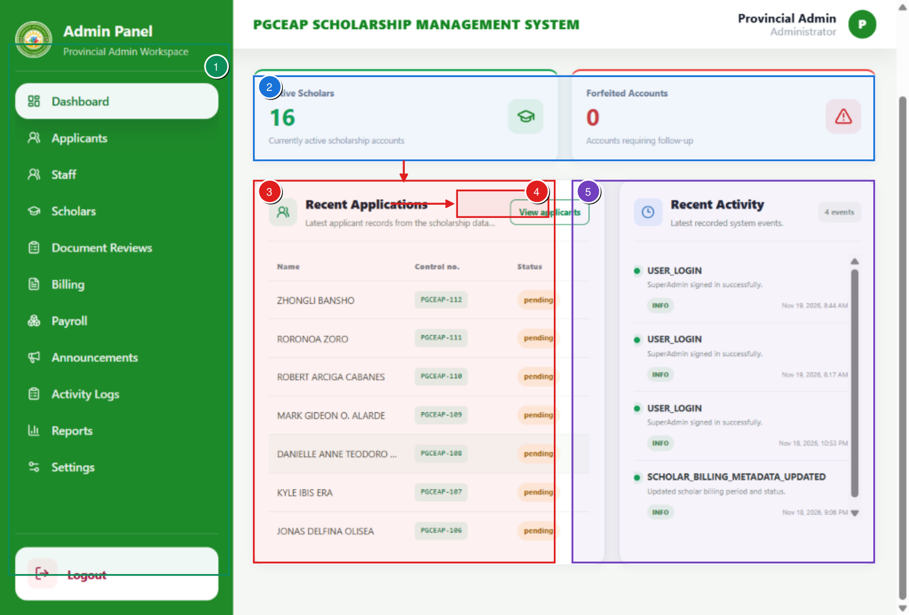
*Figure 2.1: Live Program Operations Dashboard Overview (`https://cnpgceap-sms.com/dashboard`)*

> [!NOTE]
> **Figure 2.1 Step-by-Step Directions & Workflow Walkthrough:**
> - **Direction 1 (Sidebar Navigation):** Use the left rail to switch between all 11 administrative workspaces (*Applicants*, *Staff*, *Scholars*, *Document Reviews*, *Billing*, *Payroll*, *Settings*, etc.).
> - **Direction 2 (Check Telemetry):** Review active scholar enrollment counts and ensure the green *Live data* polling indicator is active.
> - **Direction 3 (Monitor Inbound Submissions):** Inspect newly arrived applicant profiles (e.g. Bansho, Zoro, Cabanes) and their current submission statuses.
> - **Direction 4 (Quick Action Link):** Click the **"View applicants"** shortcut to jump directly to the master applicant screening table.
> - **Direction 5 (Verify Activity Stream):** Audit the real-time activity log for recent administrative sign-ins (`USER_LOGIN`) and scholar metadata updates.
> - **Administrator Routine:** Start each business day by verifying Direction 2 (Telemetry) and Direction 3 (Inbound Submissions) to plan exam scheduling sessions.

```
+-----------------------------------------------------------------------------------+
| PROGRAM OPERATIONS > Dashboard Overview                             [Live data]   |
| Monitor scholarship accounts, recent applications, and program activity.          |
+-----------------------------------+-----------------------------------------------+
| Active Scholars: 16               | Forfeited Accounts: 0                         |
| Currently active scholarship accts| Accounts requiring follow-up                  |
+-----------------------------------+-----------------------------------------------+
| RECENT APPLICATIONS                                                               |
| Zhongli Bansho (PGCEAP-112) | Roronoa Zoro (PGCEAP-111) | Robert Cabanes ...      |
+-----------------------------------------------------------------------------------+
| RECENT ACTIVITY                                                                   |
| USER_LOGIN · SuperAdmin signed in successfully · Nov 19, 2026, 8:44 AM            |
| SCHOLAR_BILLING_METADATA_UPDATED · Updated scholar billing status ...              |
+-----------------------------------------------------------------------------------+
```

- **Live Data Feed:** Automatically polls every 5 to 10 minutes to maintain current telemetry without placing heavy loads on the database.
- **Metric Cards:** Direct drill-down links allow staff to jump immediately to the filtered Scholar directory.
- **Recent Applications:** Instant roster of the latest online submissions displaying applicant names, control numbers, and pending statuses.
- **Recent Activity:** Real-time operational audit log displaying recent administrative events.

---

## 3. Applicants & Examination Management

Access this workspace via **Applicants** in the sidebar. It contains four unified subtabs:

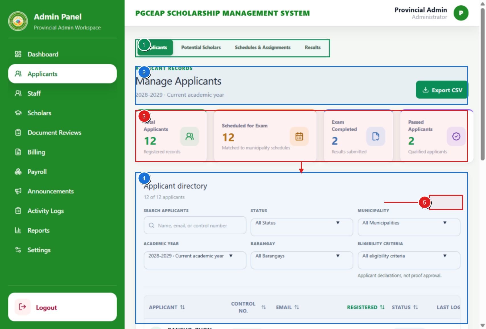
*Figure 3.1: Applicants Directory & Multi-Parameter Filter Workspace (`/dashboard -> Applicants`)*

> [!NOTE]
> **Figure 3.1 Step-by-Step Directions & Workflow Walkthrough:**
> - **Direction 1 (Select Tab):** Switch between *Applicants* (roster), *Potential Scholars* (passers), *Schedules & Assignments* (venues), and *Results* (scoring).
> - **Direction 2 (Review Metrics):** Monitor overall progress across Total Applicants, Scheduled for Exam, Exam Completed, and Passed.
> - **Direction 3 (Apply Filters):** Filter applicants by Municipality (all 12 LGUs), Barangay, Academic Year, and declared Priority Criteria (Honors, ALS, PWD, Solo Parent, IP).
> - **Direction 4 (Inspect Roster):** Browse matching applicant rows showing name, control number, email, and registration timestamps.
> - **Direction 5 (Open Scorecard):** Click the **"View"** button on any row to open the 100-Point Explainable Recommendation Scorecard.
> - **Scorecard Direction:** Inspect contributing factors on the scorecard. If manual acceptance is warranted contrary to recommendation, check *Override recommendation* and enter a required written justification.

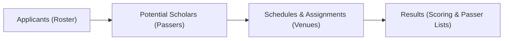

### 3.1 Applicants Workspace (`Applicants` Tab)
- **Search Bar:** Real-time search by applicant name, email address, or control number (`PGCEAP-XXX`).
- **Filter Bar:**
  - **Status:** `All Status`, `Accepted as scholar`, `For review`, `Pending`.
  - **Municipality:** Filter by all 12 municipalities of Camarines Norte (*Basud, Capalonga, Daet, Jose Panganiban, Labo, Mercedes, Paracale, San Lorenzo Ruiz, San Vicente, Santa Elena, Talisay, Vinzons*).
  - **Barangay:** Populates dynamically based on the selected municipality.
  - **Academic Year:** Toggle between the current active intake period and historical archives.
  - **Eligibility Criteria:** Filter by declared priority (e.g., *Valedictorian / Highest Honors, Academic Contest Champion, ALS Passer, PWD, Child of PWD, Solo Parent, Indigenous Group*).
- **Export CSV:** Exports the filtered applicant roster with formula-injection sanitization.

#### Explainable Eligibility Recommendation Engine
When viewing an applicant record, staff can inspect the system's **100-Point Recommendation Scorecard**:
- Highlights contributing factors such as gross household income, academic contest standing, or priority status.
- Displays policy version (e.g., `PGCEAP-2026.1`) and advisory recommendation.
- **Administrative Override:** If staff need to accept an applicant contrary to the scorecard recommendation, check **"Override recommendation"** and enter a required written justification. Overrides are permanently recorded in the Activity Log.

---

### 3.2 Potential Scholars (`Potential Scholars` Tab)
- Identifies applicants who passed the qualifying examination or qualified through priority verification and are pending formal scholar onboarding.
- **Batch Acceptance:** Authorized staff can select verified passers and click **"Accept as Scholar"** to promote them to active scholar status.

---

### 3.3 Examination Schedules & Assignments (`Schedules & Assignments` Tab)
- **Municipality Venue Cards:** Each municipality has a dedicated scheduling card.
- **Configuring Venue & Mode:**
  1. Click **"Edit"** on a municipality card.
  2. Set the **Venue** (e.g., *Mabini Colleges Gymnasium* or *Daet Heritage Center*).
  3. Select **Delivery Mode**: `Paper and Pen` or `Online Examination`.
  4. Specify the **Date Range** and **Reporting Time** in Philippine Standard Time (UTC+8).
  5. Upload an optional venue reference photo.
- **Activation & Deactivation:**
  - Click **"Activate"** to make the schedule visible to applicants in that municipality.
  - Click **"Deactivate"** or use the global **"Deactivate all"** action if schedules need revision.
- **Roster & Attendance:**
  - Click **"View applicants"** on any active venue card to review scheduled examinees.
  - Download the official printable PDF Attendance Roster.

---

### 3.4 Results Management (`Results` Tab)
- **Score Input (Paper Exams):** Enter written and objective exam scores directly into the Results table.
- **Score Computation (Online Exams):** The system automatically populates objective test scores.
- **Publishing & Locking the Passer List:**
  1. Verify score thresholds.
  2. Click **"Publish Passer List"**. Once published, examinees can view their passing status in the Applicant Portal.
  3. Click **"Lock Passer List"** to permanently freeze results against further edits.

---

## 4. Document Reviews & Verification Queue

Access this workspace via **Document Reviews** in the sidebar.

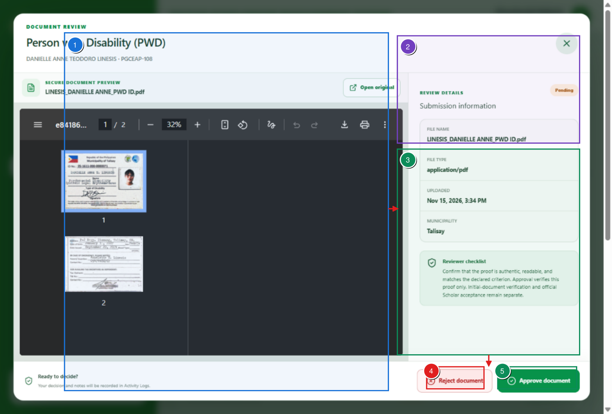
*Figure 4.1: Scholar-Grouped Document Review Queue & Preview Modal (`/dashboard -> Document Reviews`)*

> [!NOTE]
> **Figure 4.1 Step-by-Step Directions & Workflow Walkthrough:**
> - **Direction 1 (Examine Document):** Inspect the submitted PDF or image in the secure, high-contrast document preview pane (zoom, pan, multi-page).
> - **Direction 2 (Check Metadata):** Confirm file name, upload date/time, and applicant municipality on the right-hand panel.
> - **Direction 3 (Evaluate Checklist):** Verify the submission against displayed institutional standards (registrar dry seal, passing GPA, enrolled unit count).
> - **Direction 4 (Reject & Note):** If deficient, click **"Reject document"** and enter a mandatory, clear correction note returned directly to the scholar's portal.
> - **Direction 5 (Approve Requirement):** If valid, click **"Approve document"** to confirm the requirement and advance scholar readiness.
> - **Bulk Approval Rule:** You may use *"Approve all pending requirements"* for routine continuing submissions. **Priority Proofs** (PWD, Solo Parent, IP, Honors) must be verified individually via Directions 1–5.

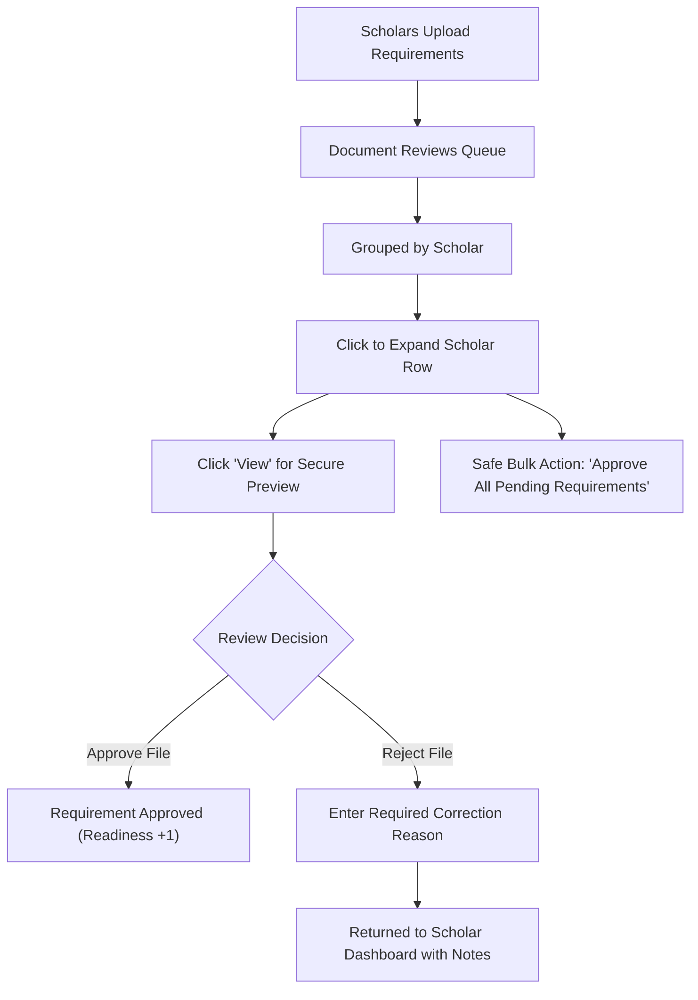

### 4.1 Grouped Scholar Architecture
- Instead of loose file lists, reviews are grouped by scholar, showing total pending files, approved count, and returned count.
- Click any scholar row to expand their file checklist.

### 4.2 Secure Document Previewer
- Click **"View"** beside any submitted file to open the embedded modal viewer.
- PDF files and high-resolution JPG/PNG images render in a contained high-contrast viewer without exposing cloud storage URLs.

### 4.3 Decisions & Mandatory Rejection Notes
- **Approve:** Approves the requirement and updates the scholar's readiness counter.
- **Reject:** Prompts for a specific administrative correction reason (e.g., *"Certificate of Grades has no official registrar dry seal. Please request an authenticated copy."*). The note immediately appears on the Scholar Portal.

### 4.4 Bulk Approval Safeguards
- **Ordinary Requirements:** Authorized staff can use **"Approve all pending requirements"** to approve all valid documents for that scholar at once.
- **Priority Proof Uploads:** Priority criteria proofs (PWD, Solo Parent, IP, Honors) **must be individually inspected and approved**. The bulk action intentionally bypasses priority proofs to maintain verification integrity.

---

## 5. Scholars Management & Lifecycle Tracking

Access this workspace via **Scholars** in the sidebar. It features three section tabs:

```
Scholars Section Tabs:
[ Scholar (Directory) ]   [ Continuing Requirements ]   [ Graduates & Latin honors ]
```

### 5.1 Scholar Directory
- Comprehensive master list of all accepted scholars across all batches.
- **Year Level Filter:** Filter by *Incoming 1st Year, 2nd Year, 3rd Year, 4th Year, 5th Year*, or *Not specified*.
- **Search & Exports:** Search by name, scholar ID, or school; export filtered records to CSV.

### 5.2 Scholar Detail Drawer
Click **"View details"** on any scholar row to open the sliding detail drawer:
1. **Overview Tab:** Personal information, enrolled school, course, and initial document checklist.
   - *Administrative Capture:* If initial hardcopy requirements were submitted at CAO, use the **Direct Webcam**, **QR Phone Pairing**, or **File Upload** tools to attach documents directly.
2. **Graduation & Honors Tab:** Tracks graduation clearance, diplomas, and recorded Latin Honors (*Summa Cum Laude, Magna Cum Laude, Cum Laude*).
3. **Billing & Payroll Tab:** Prepares the processing session for the selected academic period.
4. **Certification History Tab:** Houses individual generated certification PDFs for private-school scholars. Staff can preview or re-download saved certificates.

### 5.3 Continuing Requirements Tab
- Staff select the target Academic Period and toggle **Continuing uploads**:
  - `Open`: Scholars can upload periodic Grades, Registration Forms, and Tuition Receipts.
  - `Closed`: Uploads are locked; historical submissions remain preserved.

---

## 6. Billing Workspace (Private-School Grant Certification)

Access via **Billing** in the sidebar. Billing manages tuition assistance verification for Private-School Scholars.

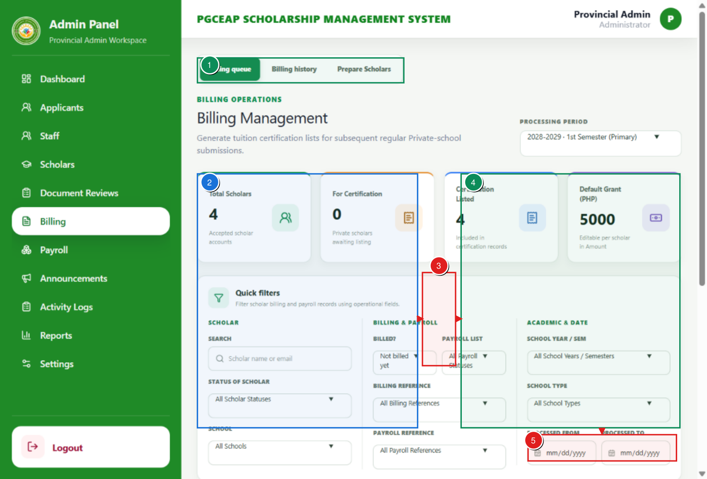
*Figure 6.1: Billing Queue & Dual-List Transfer Workspace (`/dashboard -> Billing`)*

> [!NOTE]
> **Figure 6.1 Step-by-Step Directions & Workflow Walkthrough:**
> - **Direction 1 (Period & Subtabs):** Select the active Academic Period (e.g. 1st Semester Primary) and open *Prepare Scholars* first to save tuition fee breakdowns.
> - **Direction 2 (Select Source Scholars):** In the left box (*List of Scholars*), review private scholars whose grants are prepared and ready.
> - **Direction 3 (Transfer Records):** Click the center arrow buttons (`Move selected` or `Move all eligible`) to move scholars into the queue.
> - **Direction 4 (Review Staged Queue):** In the right box (*For Billing*), verify the final batch membership and grant allocations.
> - **Direction 5 (Generate Certification):** Click **"Generate certification list"** to commit the batch, assign reference numbers, and download the official Word (`.docx`) certification document.
> - **Sequential Prerequisite:** Never skip **Prepare Scholars**. Tuition Fee Assistance must be saved from official receipts before list generation.

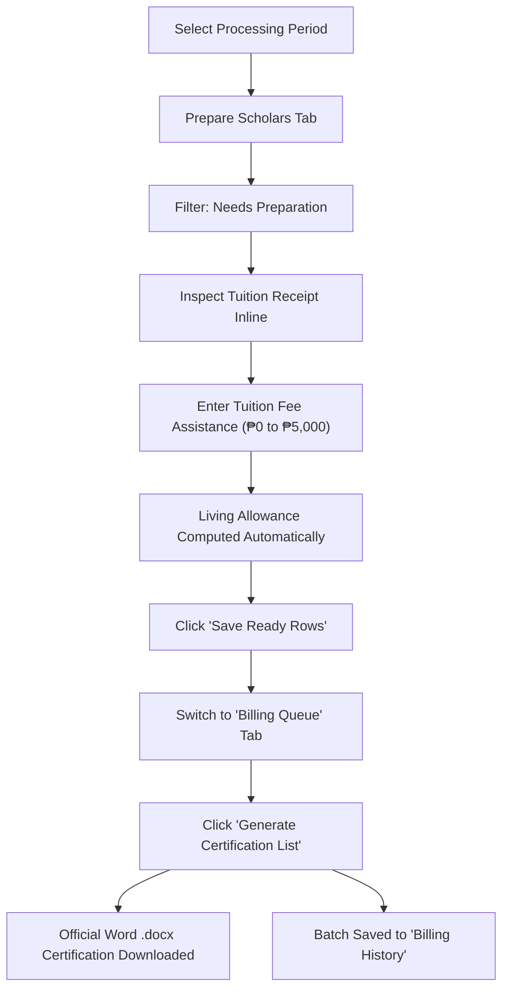

### 6.1 Private-School Grant Calculation Policy
Private-school scholars receive a fixed educational grant cap of **₱5,000.00** per semester:

$$\mathbf{Total\ Grant} = \text{PHP } 5,000.00$$
$$\mathbf{Tuition\ Fee\ Assistance} = \text{Entered from official school receipt (PHP } 0.00 \text{ to } 5,000.00\text{)}$$
$$\mathbf{Living\ Allowance} = \text{PHP } 5,000.00 - \mathbf{Tuition\ Fee\ Assistance}$$

- *Tuition assistance must be an explicit number. Enter `0.00` explicitly if tuition is fully covered by another grant; blank is not treated as zero.*

---

### 6.2 Prepare Scholars Tab (`BatchScholarBillingPreparation`)
- **Status Filters:**
  - `Needs preparation`: Scholars awaiting tuition fee entry or having unverified drafts.
  - `Prepared`: Scholars whose grant breakdowns are saved and ready for listing.
- **Split-Screen Receipt Review:** Focusing an amount field or clicking **"Review receipt"** opens the scholar's submitted official receipt in an adjacent preview pane.
- **Bulk Entry:**
  - Check multiple scholars $\rightarrow$ Enter uniform tuition $\rightarrow$ Click **"Apply to selected"**.
  - Or click **"Set selected tuition to zero"** for scholars on full academic scholarships.
- **Save Ready Rows:** Valid rows are committed in bulk and staged into the **Billing queue**.

---

### 6.3 Billing Queue & List Generation
- Switch to the **Billing queue** tab.
- Review staged records, school breakdowns, and total grant figures.
- Click **"Generate certification list"**:
  1. Assigns a permanent Billing Reference (e.g., `BILL-2026-1ST-001`).
  2. Locks included scholars against duplicate processing for the period.
  3. Automatically downloads the official **Word (`.docx`) Certification List**.
- Click **"Export Excel"** if a preliminary preparation spreadsheet is needed.

---

### 6.4 Billing History Tab
- Archives all completed billing batches.
- Click **"Download Word"** on any historical batch to re-export the certified document.

---

## 7. Payroll Workspace (Public & Remaining Private Scholars)

Access via **Payroll** in the sidebar.

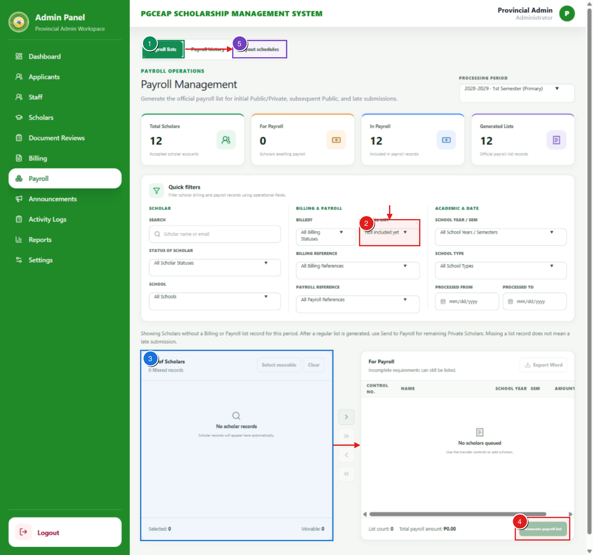
*Figure 7.1: Payroll Queue & List Generation Workspace (`/dashboard -> Payroll`)*

> [!NOTE]
> **Figure 7.1 Step-by-Step Directions & Workflow Walkthrough:**
> - **Direction 1 (Confirm Workspace):** Ensure the *Payroll lists* tab is active and the correct academic period is selected.
> - **Direction 2 (Filter Unprocessed):** Set the Payroll List filter to **"Not included yet"** to isolate eligible scholars.
> - **Direction 3 (Check Roster):** Select public scholars (or remaining private scholars via *Send to Payroll*) to include in the batch.
> - **Direction 4 (Generate Payroll List):** Click **"Generate payroll list"** to finalize the batch, assigning reference numbers and downloading Word and formatted Excel (`.xlsx`) files.
> - **Direction 5 (Publish Payout Schedule):** Switch to the **"Payout schedules"** tab to set dates and venues for this finalized batch.
> - **Excel Default:** In generated Excel files, unassigned tuition/allowance breakdowns automatically default to numeric `0.00` while preserving the full stipend amount.

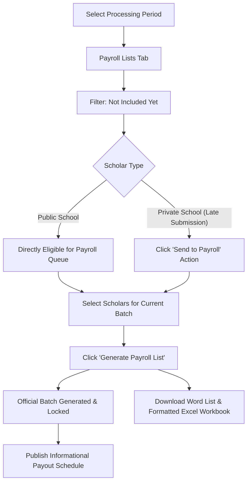

### 7.1 Public Routing & "Send to Payroll" for Remaining Private Scholars
- **Public Scholars:** By policy, public-school scholars bypass tuition receipt verification and proceed directly to Payroll.
- **Initial Semester Private Scholars:** Also prepared through Payroll for their first semester.
- **"Send to Payroll" Action:** If a regular Billing batch has already been generated for the period and additional private scholars submit requirements late, staff locate them under *Not included yet* and click **"Send to Payroll"** to route them into a supplemental payroll batch.

---

### 7.2 Generating the Official Payroll List
1. Open **Payroll lists** and select the active **Processing Period**.
2. Set the Payroll List filter to **"Not included yet"**.
3. Select the scholars to include in the batch.
4. Click **"Generate payroll list"**:
   - Generates a permanent Payroll Reference (e.g., `PAY-2026-1ST-001`).
   - Downloads the official **Word document** and **Excel (`.xlsx`) workbook**.
   - *Excel Default:* In generated Excel files, any missing tuition or allowance breakdowns automatically default to numeric `0.00` while preserving the total stipend amount.

---

### 7.3 Payout Schedules & Staff Attendance Administration

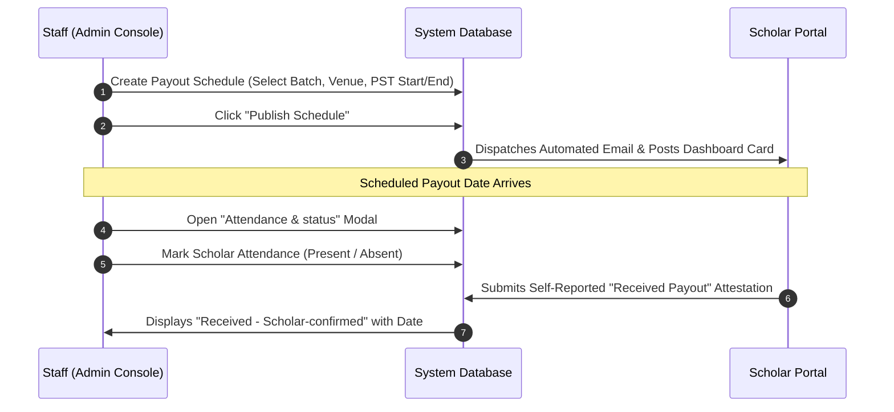

#### 1. Creating and Publishing a Schedule
1. Open **Payroll → Payout schedules** and click **"Create schedule"**.
2. Select an official saved Payroll Batch.
3. Enter the **Schedule Title**, **Venue** (e.g., *Municipal Town Hall*), and **Start/End Date & Time** in Philippine Standard Time.
4. Filter and check the recipient scholars from that batch.
5. Click **"Publish Schedule"**. The system immediately sends automated Gmail notifications to recipients and displays the schedule card in their portals.

#### 2. Recording Staff Attendance
1. Click **"Attendance & status"** on the published schedule card.
2. For each scholar, record their physical presence:
   - `Not marked` (default)
   - `Present` (scholar attended venue)
   - `Absent` (scholar did not appear)
3. Attendance is saved in real time.

#### 3. Monitoring Scholar Self-Reported Acknowledgements
- The modal displays the scholar's self-reported status in the **Payout Status** column:
  - `Not confirmed`: Scholar has not yet confirmed receipt.
  - `Received — scholar-confirmed [Date]`: Scholar completed their voluntary acknowledgement.
- *Strict Rule: Staff cannot force or confirm receipt for a scholar. Attendance and receipt acknowledgement remain strictly separate.*

---

## 8. Staff Management & Granular Permissions

Access via **Staff** in the sidebar *(Super Administrator Only)*:

```
Staff Directory Controls:
[ Search staff by name/email ]   [ Role Filter ]   [ Active/Inactive Filter ]   [ + Add staff member ]
```

### 8.1 Adding & Editing Staff Accounts
- Click **"+ Add staff member"** to create a new administrator account.
- Assign the staff role:
  - `SuperAdmin`
  - `RegularAdmin`
  - `BillingPayrollAdmin`
- Enter their name, official email address, and temporary password.

### 8.2 Granular Section-Level Permissions
Super Administrators can restrict a staff member's sidebar access to specific operational modules:
- Check or uncheck permissions: *Applicants, Examination, Scholars, Document Reviews, Billing, Payroll, Announcements, Reports*.
- When a staff member logs in, their navigation sidebar only displays authorized sections.

### 8.3 Account Security & Safeguards
- **Active Status Toggle:** Instantly disable an account if a staff member transitions off the project. Existing active sessions are invalidated immediately.
- **Sole SuperAdmin Protection:** The system strictly prevents deleting or deactivating the last remaining active SuperAdmin account.

---

## 9. System Settings & Configuration

Access via **Settings** in the sidebar *(Super Administrator Only)*. Contains six specialized tabs:

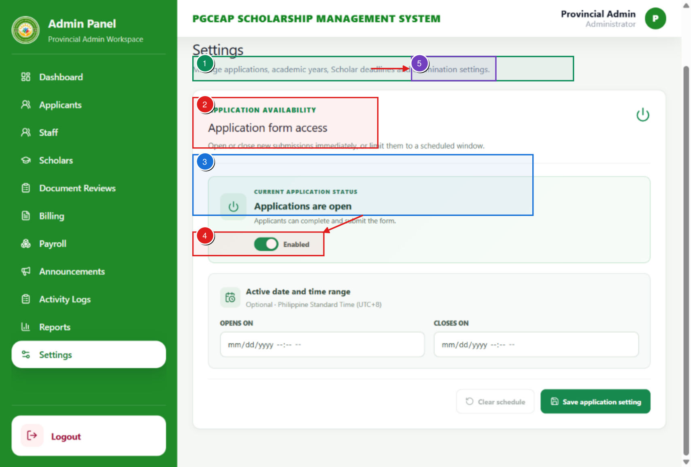
*Figure 9.1: System Settings & Application Form Access Windows (`/dashboard -> Settings`)*

> [!NOTE]
> **Figure 9.1 Step-by-Step Directions & Workflow Walkthrough:**
> - **Direction 1 (Settings Navigation):** Switch between tabs (*Applications*, *Academic Year*, *Requirements*, *Examination*, *School Catalog*, *System Health*).
> - **Direction 2 (Immediate Toggle):** Switch the radio toggle between `Enabled` (open immediately) and `Disabled` (close immediately).
> - **Direction 3 (Schedule Time Window):** Set optional *Opens on* and *Closes on* timestamps in Philippine Standard Time (UTC+8).
> - **Direction 4 (Commit Settings):** Click **"Save application setting"** to enforce the schedule across the public portal.
> - **Direction 5 (School Catalog Routing):** Open the **School Catalog** tab to configure institutions as Public or Private (controlling Billing vs. Payroll routing).
> - **Routing Integrity:** Never change a school's classification during an active batch cycle, as it drives downstream Billing vs. Payroll eligibility.

```
Settings Tabs:
[ Applications ] [ Academic Year ] [ Requirements ] [ Examination ] [ School Catalog ] [ System Health ]
```

### 9.1 Applications Tab (Form Availability)
- **Status Toggle:** Toggle between `Enabled` (Applications are open) and `Disabled` (Applications are closed).
- **Scheduled Windows:** Set an automated **Opening Date/Time** and **Closing Date/Time** in Philippine Standard Time (UTC+8). When the window closes, the public form automatically stops accepting submissions.

### 9.2 Academic Year Tab
- Configure academic years (e.g., `2026-2027`, `2027-2028`) and semesters (`1st Semester`, `2nd Semester`).
- Designate the **Primary System Period** (governs public application intake, exam assignments, and default reporting).
- Keep secondary periods active for ongoing Billing/Payroll processing.

### 9.3 School Catalog Tab
- Search and maintain the list of recognized higher education institutions.
- Update institutional classifications: **Public** or **Private**.
- *Caution: Changing a school's classification changes the routing of its scholars between Billing and Payroll.*

### 9.4 System Health Tab
- Real-time telemetry monitoring API response latency, memory utilization, and PostgreSQL database connection health.

---

## 10. Activity Logs, Announcements & Reports

### 10.1 Operational Activity Logs (`Activity Logs` Tab)
- Real-time immutable audit trail recording all user logins, application status changes, document approvals/rejections, and batch list generations.
- Searchable by actor email, action type (e.g., `USER_LOGIN`, `DOCUMENT_APPROVED`), or date range.

### 10.2 Announcements Management (`Announcements` Tab)
- Publish notices with titles, descriptions, and optional banner images.
- Set target visibility: `Public / Landing Page`, `Applicants Only`, or `Scholars Only`.

### 10.3 Reports & Analytics (`Reports` Tab)
- **Reporting Tabs:** `Overview`, `Intake & processing`, `Priority locations`, `Fourth-year records`, `Scholar records`.
- **Financial Metric Cards:** Summarizes total generated payroll amounts, tuition fee allocations, and allowance totals. *(Reflects generated list amounts; does not represent released money).*
- **Excel Exports:** Click **"Export XLSX"** to download complete, formatted analytical workbooks protected against formula injection.

---

## 11. Administrator Troubleshooting & Safety Checklist

| Issue / Scenario | Root Cause | Recommended Action |
| :--- | :--- | :--- |
| **Private scholar cannot be added to Billing** | Scholar's school is classified as Public. | Verify classification in **School Catalog**. Public scholars must be processed in **Payroll**. |
| **"Set tuition before billing" error** | Private scholar grant breakdown is unconfigured. | Open **Billing → Prepare Scholars** or the scholar's drawer, enter tuition assistance, and save. |
| **"Already listed in period" error** | Scholar was already processed in a previous batch for this semester. | Scholars cannot be listed twice in the same period. Select another active period if preparing for a new term. |
| **Cannot see "Send to Payroll" button** | No regular Billing batch has been generated yet for this period. | Generate the regular Billing batch first; "Send to Payroll" is reserved for subsequent remaining scholars. |
| **Cannot mark payout attendance** | Payout schedule start date/time has not arrived. | Attendance recording is disabled until the published schedule date/time starts. |
| **Scholar cannot confirm receipt** | Payout schedule has not started or was cancelled. | Ensure the schedule is published and active; scholars can only confirm receipt after the start date. |

---

*Provincial Government College Educational Assistance Program (PGCEAP)*  
*Community Affairs Office (CAO), Province of Camarines Norte*
