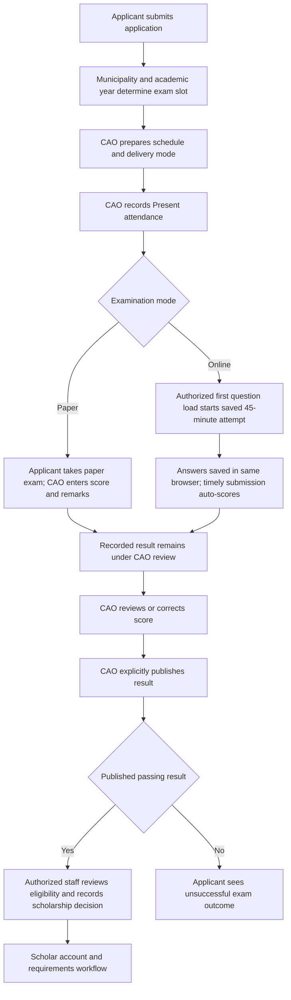

# Examination process review: beginning to end

Date: 2026-10-12 (Asia/Manila). Initial review baseline `4f5fbfb` (QA-10 release
`709e770`). The review itself changed no application code or production records.
Subsequent authorized local implementation is recorded in Fix status below;
nothing was deployed.

**Initial review outcome:** the ordinary paths have passing regression/browser evidence, but
six additional boundary gaps were reproduced with synthetic controller probes.
These gaps are not covered by the earlier QA-01–QA-11 passing matrix. They must
not be described as successful production acceptance.

## Fix status after authorized implementation

EXAM-01 through EXAM-06 are implemented locally. See the dated detailed change
entry and [fix register](../../qa-fix-register.md): exact reviewed-result and
application/period-bound Serializable acceptance, shared terminal-state guards,
current-result projections, primary-period selection and expired status/access.
231 backend checks and 70 frontend checks passed; one existing database test
skipped, lint/build and six synthetic browser runs passed. No migration or
deployment. The findings/reproductions below preserve the pre-fix review evidence;
production/database-concurrency acceptance and additional policy decisions remain.

## Current process

Present attendance produces For review; it is not completion, a score or a
passing decision. Paper scores are manual, bounded to 0–20, with a recording
remark and passing threshold. Online scoring uses the attempt's saved objective
bank and threshold. Refresh cannot restart the deadline. An unsubmitted expired
attempt is locked; the current implementation does not automatically submit
answers, create a zero score or declare a failed result.

Scores/thresholds stay private until publication. Correction requires a reason,
keeps history and resets publication. Published passing results permit human
eligibility review; passing alone never automatically creates a scholar account.
A configured recommendation requiring override needs a recorded decision reason.
Already accepted/priority scholar paths are separate from this ordinary qualifying
exam path. The subsequent system workflow still ends at official payroll-list
generation, not released-money confirmation.

Settings-authorized staff manage the global paper/online switch and versioned
online bank. Examination-authorized staff manage schedules/attendance and
score review/publication. Scholarship acceptance is currently restricted by its
route to SuperAdmin or BillingPayrollAdmin with examination access; RegularAdmin
examination access alone does not permit acceptance.

## Reproduced findings

The review probes invoke the existing controllers with an in-memory database and
stubbed email. Their successful assertions mean the **undesired behavior was
reproduced**, not that the workflow is correct. None used production records.
IDs here are local review labels, not a renumbering of the original QA findings.

### EXAM-01 — P1: Acceptance is not bound atomically to the reviewed result

**Evidence:** [acceptance controller](../../../backend/controllers/applicationController.js)
reads the latest passing/published result before starting its write transaction.
[Results UI](../../../frontend/src/ResultsManagement.jsx) sends only reviewReason;
it does not send the reviewed exam/result/revision. The acceptance transaction
uses that earlier snapshot without rechecking result state.

**Reproduction:** expose a passing published result, then replace it with a failed,
unpublished correction immediately before the acceptance write transaction.
The controller still returns 201 and creates an active scholar referencing the
result that now fails. The existing publication/correction lock after acceptance
does not close the opposite interleaving where correction wins first.

**Recommendation:** send the exact reviewed exam ID, result ID and revision;
revalidate publication, pass status, application availability and period within
a transaction with appropriate concurrency protection. Acceptance and correction
must not both commit incompatible decisions. Add both interleaving regression
cases and test database semantics in staging. This is distinct from QA-07's
already-tested atomic online score/status submission.

### EXAM-02 — P1: Historical results can qualify a current-period decision

**Evidence:** acceptance selects the latest result by applicant and created_at
without constraining exam/year/current assignment. Applicant and staff projections
also prefer the latest all-year result over the current scheduled exam. They can
therefore display a prior result and obscure current examination progress.

**Reproduction:** a current-year applicant with a current application and only an
older passing/published result from another exam is accepted with HTTP 201. The
eligibility decision is recorded under the current academic period using the
historical result. The probe uses a reviewer reason to satisfy ordinary eligibility
review; no reason authorizes reuse of another year's exam in the current code.

**Recommendation:** identify the exact eligible current examination/application
and enforce that identity in reads and acceptance, with an explicit separately
reviewed policy if prior results may ever carry forward. Keep historical results
available as history rather than silently treating them as current.

### EXAM-03 — P1: Rejected/declined status is not protected during online submission

**Evidence:** online submission's application update excludes Withdrawn only,
using applicant_id rather than the exact eligible application. Paper result
handling already excludes withdrawn, rejected and declined applications.

**Reproduction:** start a synthetic valid timed attempt, set its application to
Rejected, submit before the deadline. The controller returns 201, records a result
and overwrites Rejected with Examined. Declined is likewise not excluded by the
query; the executed probe specifically used Rejected. The query could update
multiple matching applications if such records exist; that was not reproduced.

**Recommendation:** use a shared explicit eligible-state rule and exact application
identity across paper/online operations. Verify eligibility within the submission
transaction and roll back when it no longer holds. Do not revive a terminal decision
as an incidental effect of submitting an exam.

### EXAM-04 — P2: Withdrawn applicants can still retrieve/start online questions

**Evidence:** question access checks settings, schedule, slot attendance and prior
result, but does not load/check the application status. The shared online-access
predicate also lacks this status check.

**Reproduction:** set the application to Withdrawn with Present attendance and an
otherwise open online schedule. GET questions returns 200, supplies a ticket and
starts the persisted attempt. Actual submission rejects a withdrawn application
through the zero-update guard; the gap concerns access/start and consumed time.

**Recommendation:** verify the current eligible application before exposing
questions or claiming an attempt. Use the same policy in portal guidance, question
loading and submission. Review account/deleted-applicant eligibility consistently.

### EXAM-05 — P2: Paper review uses a different active-period selection rule

**Evidence:** the main controller resolves the active primary period first, while
[paper result controller](../../../backend/controllers/examinationResultController.js)
selects the most recently updated active period without requiring is_primary.
The system supports multiple active periods and a separate primary selection.

**Reproduction:** configure an active primary 2026–2027 period and a more recently
updated active secondary 2027–2028 period in the synthetic transaction. A valid
primary-year paper result returns 409, Select an examination in the active academic
year, because the result controller chose the secondary year. No score is written.
The same selector is used for correction/publication.

**Recommendation:** centralize period resolution and use the same primary/fallback
rule for scheduling, online access, result mutations and acceptance. Add a regression
with multiple active periods and one primary; do not rely on updated_at to imply
primary status.

### EXAM-06 — P2: Expired attempts still look accessible on the applicant dashboard

**Evidence:** [online-access predicate](../../../backend/services/examinationAccess.js)
checks schedule/mode/attendance/completion but not the slot's persisted deadline.
The portal supplies access.allowed using that predicate; question loading separately
rejects expired attempts through assertAttemptOpen.

**Reproduction:** set an unsubmitted Present attempt's deadline 15 minutes in the
past while its schedule remains open. The applicant projection returns For review
and access.allowed=true, but loading questions returns HTTP 410. The dashboard is
advertising an action the server will refuse.

**Recommendation:** expose a distinct expired/unsubmitted attempt state and disable
Start/Continue with clear CAO guidance. Keep deadline enforcement authoritative on
the server. Define a controlled incident/retake policy separately; do not silently
reset deadlines, submit old drafts or invent a zero score.

## Additional policy and operational checks

These are source observations/review questions, not additional reproduced failures:

- Attendance controls support Pending/Present only. Absent is read from legacy
  forfeited_at records, but the reviewed attendance endpoint always clears that
  field and provides no Absent action. Define how CAO closes no-show records if
  that is required.
- Mode/enabled settings are global and are rechecked at online submission. CAO
  switching mode/off or deactivating the schedule can interrupt a started attempt.
  Establish an operational policy for configuration changes during examination.
- Calendar windows use Manila dates. An attempt started near the last day's
  midnight may have a 45-minute deadline beyond the schedule window, yet submission
  also requires the window to remain open. Decide whether to prevent late starts,
  cap the deadline or honor started attempts; do not assume all starters have a full
  45-minute usable window at that boundary.
- Failed network responses after a committed submission remain uncertain outcomes.
  Existing recorded receipts, duplicate guards and reload handling must be retained;
  verify with dedicated staging records rather than replaying real submissions.

## Validation and limits

Six temporary review-only probes reproduced all six findings against current
controller functions, using mocked database responses, synthetic records, stubbed
mail and a local HTTP test server. The first temporary harness launch failed due
to relocated relative module paths; those paths were corrected, then all six
probes completed successfully. No application source/test file was changed.

The earlier same-baseline [QA fix verification](fix-verification.md) recorded
216 backend and 69 frontend checks passing, one opt-in real-database catalog test
skipped, lint/build and nine synthetic browser runs passing. Those tests validate
their covered scenarios; they did not cover these newly exercised boundaries.
They were not repeated to manufacture a broader acceptance claim.

This review does not prove that the six conditions have occurred in production,
that real applicants have been affected or that an actual concurrent database
race was exercised. The race probe supplies a deterministic controller interleaving;
PostgreSQL behavior needs staging verification. No authenticated production session,
private Hostinger inspection, migration, real exam/scoring/acceptance mutation or
email delivery was used. Existing health/assets evidence alone is not an end-to-end
protected workflow test.

## Recommended fix and acceptance order

1. Acceptance integrity: exact result/application/period identity and concurrent
   acceptance/correction protection (EXAM-01/02).
2. Shared application-state eligibility for question access and online submission
   (EXAM-03/04).
3. Consistent primary-period selection (EXAM-05).
4. Expired-attempt dashboard state, followed by explicit no-show/incident/window
   policy decisions (EXAM-06 and additional checks).
5. After authorized fixes, add the corresponding regressions and run dedicated
   paper and online workflows through published results and acceptance in staging,
   then controlled authenticated hosted acceptance.

No fixes or deployment were executed. This review's rollback is documentation-only;
original examination/results/history data and the list-generation scope are intact.
