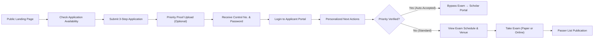
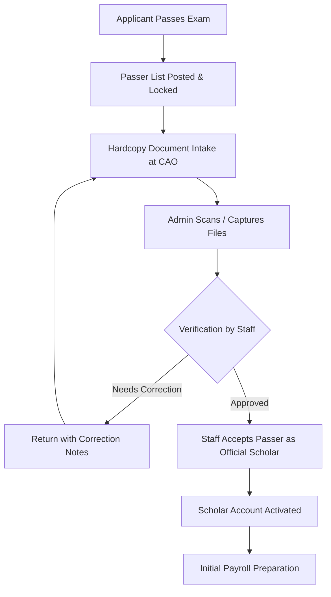
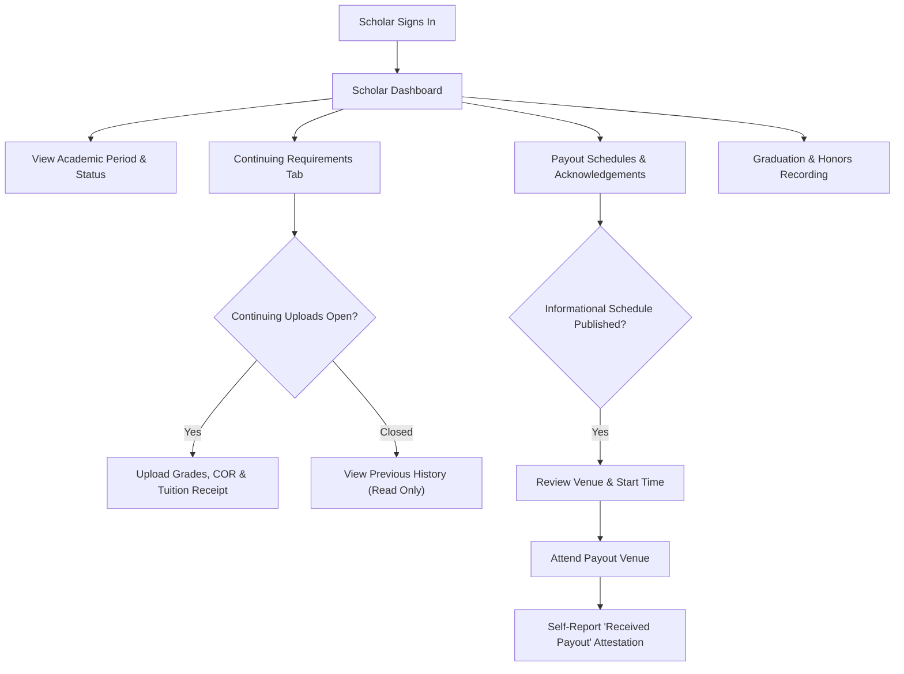
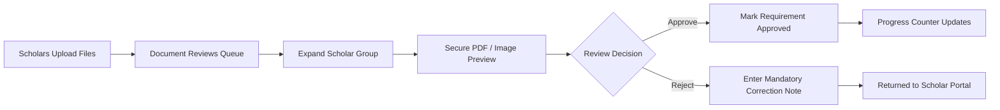
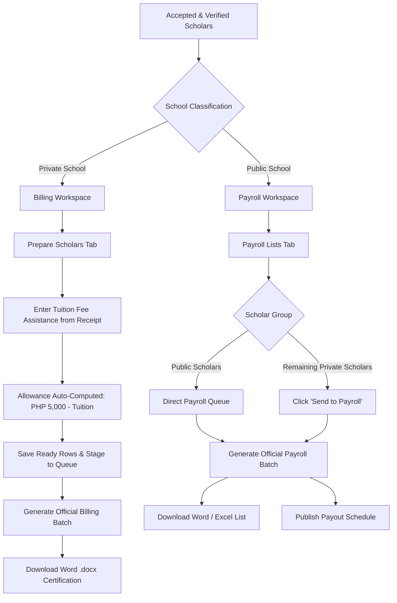
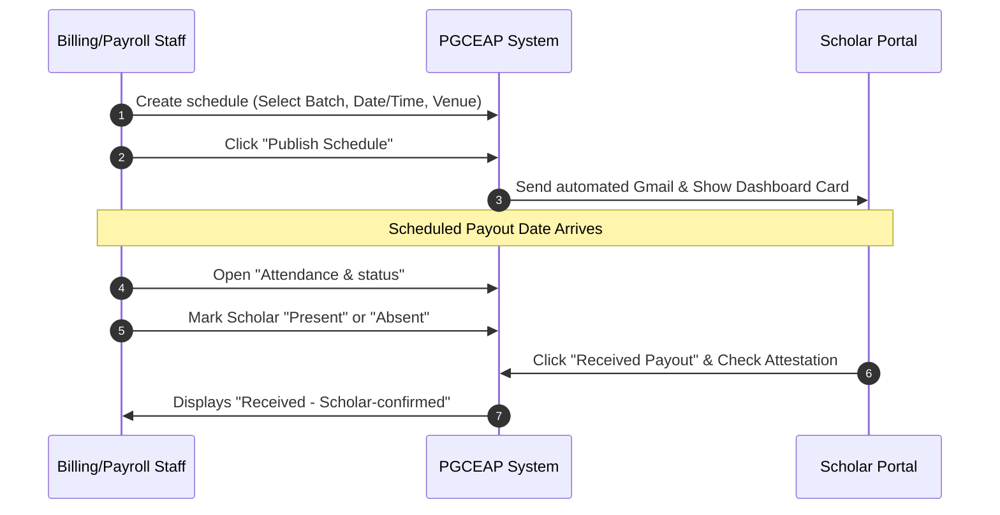

# PGCEAP Scholarship Management System — User Manual
**Provincial Government College Educational Assistance Program**  
**Community Affairs Office (CAO)**  
*Document Version: 2026.1 | Last Updated: November 2026*

---

## 1. Introduction & Operational Scope Boundary

### 1.1 Purpose of the System
The **PGCEAP Scholarship Management System** (CAO Scholar Monitoring System) is an integrated digital platform designed to streamline and govern the scholarship lifecycle under the Community Affairs Office (CAO). The platform coordinates scholarship application intake, eligibility screening, examination scheduling and scoring, initial document capture, scholar onboarding, continuing requirement reviews, and official billing and payroll list generation.

### 1.2 Product Scope Boundary & Non-Disbursement Policy
> [!IMPORTANT]
> **Strict Operational Boundary Notice:**  
> The CAO administrative workflow strictly ends when the Community Affairs Office generates and certifies the official **Payroll List** or **Billing Certification List** of eligible scholars.
> 
> The system **does NOT**:
> - Release monetary funds or disburse cash/checks;
> - Process official payment claiming or banking disbursements;
> - Conduct financial reconciliation or audits of released money;
> - Treat operational Activity Logs as monetary audits.
>
> All monetary totals displayed in Reports and lists represent **approved, generated payroll-list allocations**, not disbursed or claimed funds.

#### Limited Extension: Informational Payout Schedules & Scholar Receipt Acknowledgement
As explicitly authorized on 2026-10-21:
1. **Informational Schedules:** Authorized staff may publish informational Payout Schedules (specifying date, time, and venue) for members of a generated Payroll batch.
2. **Staff Attendance Recording:** Staff may record whether a scholar was `Not marked`, `Present`, or `Absent` at the scheduled venue.
3. **Scholar Receipt Acknowledgement:** Scholars may voluntarily submit a self-reported *"Received Payout"* confirmation for their own scheduled entry.
4. **Strict Separation:** Attendance does **NOT** equal or prove monetary receipt. Scholar acknowledgement is a self-reported personal attestation, not an official accounting disbursement verification.

---

### 1.3 User Roles & Permissions Matrix

| Functional Area | Public / Applicant | Scholar | Billing/Payroll Admin | Regular Administrator | Super Administrator |
| :--- | :---: | :---: | :---: | :---: | :---: |
| **Public Landing & Announcements** | Read | Read | Read | Read | Read |
| **Application Submission** | Create | — | — | — | — |
| **Applicant Portal & Guidance** | Own Record | — | — | View All | View All |
| **Examination Taking (Online)** | Own Exam | — | — | Manage | Manage |
| **Passer List Publication** | View Public | View Public | Manage | Manage | Manage |
| **Document Intake & Capture** | — | — | Manage | Manage | Manage |
| **Document Reviews & Approval** | — | — | Full Review | — | Full Review |
| **Scholar Portal & Requirements** | — | Own Record | — | View All | View All |
| **Prepare Scholars (Batch Billing)** | — | — | Manage | View Only | Manage |
| **Billing & Certification Lists** | — | — | Generate | View Only | Generate |
| **Payroll List Generation** | — | — | Generate | View Only | Generate |
| **Payout Schedules & Attendance** | — | View Own / Attest | Manage | Manage | Manage |
| **School Catalog Management** | — | — | View Only | View Only | Full Manage |
| **Academic Period Activation** | — | — | View Only | View Only | Full Manage |
| **Staff & User Role Administration** | — | — | — | — | Full Manage |
| **Operational Activity Logs** | — | — | — | — | Full View |
| **Statistical Reports & Exports** | — | — | Export Queue | Export Roster | Full Access |

---

## 2. Public Visitors & Scholarship Applicants



### 2.1 Public Landing Page & Requirements
Public visitors can access the portal homepage to view scholarship guidelines, key deadlines, active announcements, and frequently asked questions.

- **Check Availability:** The homepage indicates whether new applications are currently **Open**, **Closed**, or **Scheduled** for a future date/time.
- **Support Inquiries:** CAO contact information and office hours are provided in the footer.

### 2.2 Submitting an Application

Applications are submitted through a responsive 3-step digital form:

#### Step 1: Personal Information
- **Applicant Name:** First name, middle name (or check *No Middle Name*), last name, and extension (e.g., Jr., III). Names are automatically converted to uppercase.
- **Contact Details:** Valid personal email address (used for credential dispatch and notifications) and an 11-digit Philippine mobile number (`09XXXXXXXXX`).
- **Demographics:** Date of birth, sex, and civil status.

#### Step 2: Address & Academic Profile
- **Address Selection:** Select your **Municipality** from the dropdown. The **Barangay** dropdown will automatically filter to show only barangays belonging to that municipality.
- **School Selection:** Select your higher education institution from the official PGCEAP School Catalog.
- **Degree Program & Year Level:** Enter your current course/program and year level (Incoming 1st Year, 2nd Year, 3rd Year, 4th Year, or 5th Year).

#### Step 3: Family Background & Financial Information
- **Parent/Guardian Information:** Father's, mother's, or legal guardian's name, occupation, and combined annual gross household income.
- **Family Composition:** Number of dependents/siblings in the household.

#### Priority Eligibility Declarations & Proof Upload
Applicants belonging to special or disadvantaged categories may declare priority status:
1. **Academic Honors / Top Board/Contest Placement**
2. **Alternative Learning System (ALS) Completer / Passer**
3. **Person with Disability (PWD)**
4. **Child of a Person with Disability (PWD)**
5. **Solo Parent or Child of a Solo Parent**
6. **Member of an Indigenous Cultural Community / IP Group**

> [!NOTE]
> Declaring a priority criterion enables the **Priority Proof Upload** field. You must upload a clear copy of the matching official ID or certification in **PDF, JPG, or PNG** format (maximum 10 MB).  
> *Self-declaration alone does not confer priority status. Uploads are strictly verified by authorized CAO staff.*

### 2.3 Post-Submission Confirmation & Credentials
Upon successful submission, the system generates an immediate confirmation screen displaying:
- **Application Control Number:** (e.g., `APP-2026-00123`) — Your primary tracking ID.
- **Temporary Password:** An automatically generated single-use password.
- **Confirmation Email:** The credentials and login link are simultaneously dispatched to your registered email address.

---

### 2.4 Applicant Portal & Personalized Next-Actions Assistant

Applicants log in using their email address or Control Number. The **Applicant Dashboard** features an intelligent **Personalized Next-Actions Assistant**:
- **Current Milestone:** Indicates exactly what stage the application is in (e.g., *Application Received*, *Scheduled for Exam*, *Awaiting Results*, *Initial Verification*).
- **Exam Guidance Card:**
  - **Delivery Mode:** Displays whether your examination is **Paper and Pen** (venue-based) or **Online Examination**.
  - **Schedule Details:** Assigned date range, reporting time, venue address, and municipality.
- **Taking the Online Examination:**
  - If your municipality is configured for online examination and the testing window is active, a green **"Take Examination"** button becomes active.
  - Complete the objective questionnaire within the allotted time. The system records and automatically grades objective questions.
- **Forgot Password / Password Recovery:**
  - If you forget your password, click **"Forgot Password?"** on the login page.
  - Enter your email address or Control Number to receive a secure, single-use, 30-minute password reset link.

---

## 3. Passer Intake & Scholar Onboarding



### 3.1 Transition from Passer to Scholar
Passing the qualifying examination or receiving a priority recommendation does **not** instantly make an applicant an accepted scholar. All passers must undergo **Initial Requirement Verification**.

### 3.2 Required Initial Intake Documents

| Initial Requirement Document | Public School Scholars | Private School Scholars | Intake Handled By |
| :--- | :---: | :---: | :---: |
| **Certificate of Tax Exemption / Indigency** | **Required** | **Required** | CAO Admin Intake |
| **Valid Government / School ID Photocopy** | **Required** | **Required** | CAO Admin Intake |
| **Certificate of Grades (COG) / Form 138** | **Required** | **Required** | CAO Admin Intake |
| **Official Registration Form (COR / COE)** | **Required** | **Required** | CAO Admin Intake |
| **Official Tuition Fee Receipt** | *Not Required* | **Required** | CAO Admin Intake |
| **Barangay Indigency** | Optional | Optional | CAO Admin Intake |

> [!TIP]
> **Incoming First-Year Students:** Submit your Senior High School Grade 12 Report Card (Form 138). The initial college COG is marked optional for first-semester freshmen.

### 3.3 Administrative Capture Workflows
Passers present their hardcopy documents at the CAO office. Authorized staff capture and store these documents directly into the applicant's record using one of three tools:
1. **Direct Camera Capture:** Uses the workstation's built-in webcam or USB document camera.
2. **Laptop-Phone Pairing (QR Code):** Displays a secure pairing QR code on the desktop monitor. Staff can scan the code with a smartphone camera to take high-resolution document photos that transfer directly to the desktop queue in real time.
3. **Direct File Upload:** Standard file browser upload for pre-scanned PDF, JPG, or PNG files.

### 3.4 Official Scholar Acceptance
Once all required initial documents are verified and marked **Approved**, an authorized administrator clicks **"Accept as Scholar"**:
- An official **Scholar Record** and unique **Scholar ID** are generated.
- The applicant's portal access updates to the **Scholar Dashboard**.
- The scholar is registered into the active academic period and becomes eligible for **Initial Payroll List Preparation**.

### 3.5 Verified Priority Eligibility Auto-Acceptance Pathway
For applicants who declared priority criteria and uploaded valid proof:
- Staff open the **Document Reviews** queue to inspect the priority proof document.
- If the proof is authentic and satisfies CAO policy, staff click **"Approve Priority Criterion"**.
- The system atomically:
  1. Records policy version `PGCEAP-PRIORITY-2026.1`;
  2. Bypasses the examination requirement;
  3. Creates the official Scholar account;
  4. Dispatches an acceptance email to the scholar.
- *Bulk approval is deliberately prohibited for priority proof reviews to ensure individual verification.*

---

## 4. Scholars Portal Guide



### 4.1 Scholar Dashboard Overview
The Scholar Portal is the scholar's continuous home throughout their college degree.
- **Scholar Information:** Displays your registered School, Degree Program, Year Level, Scholar ID, and active Academic Period.
- **Requirement Progress Bar:** Real-time indicator of approved vs. pending documents.

### 4.2 Submitting Continuing Requirements
For every succeeding semester, scholars must submit updated academic credentials.

1. Navigate to the **Continuing Requirements** panel on your dashboard.
2. Verify that submission access is **Open** for the current academic period.
3. Upload the required files:
   - **Certificate of Grades (COG):** Previous semester's authenticated grades.
   - **Certificate of Registration (COR):** Official enrollment load for the current semester.
   - **Tuition Fee Official Receipt:** *(Private-school scholars only)* Official school receipt indicating fees assessed/paid.
4. **Correction of Returned Documents:** If a reviewer rejects an upload, the item displays a red **"Returned for correction"** badge along with the reviewer's specific remarks. Click **"Replace file"** to submit a corrected document.

### 4.3 Payout Schedules & Informational Notifications
When CAO finalizes an informational payout schedule for your batch:
- A prominent notification card appears on your Scholar Dashboard showing the **Date**, **Time**, and **Venue** (e.g., Municipal Gymnasium or School Campus).
- You will also receive an automated Gmail alert with schedule details and reminders of what IDs to bring.

### 4.4 Self-Reported "Received Payout" Acknowledgement
Following the payout schedule start date/time:
1. Log in to your Scholar Dashboard.
2. Locate the **Payout Attendance & Receipt** section.
3. Click the **"Received Payout"** button.
4. Select the actual date you received your grant and check the attestation box:
   > *"I hereby confirm that I have personally received my educational assistance for this scheduled payroll period."*
5. Click **"Confirm Receipt"**.
6. **Withdrawing / Correcting a Mistake:** If you submitted an acknowledgement by error, click **"Correct receipt report"** to withdraw or update your submission.

> [!NOTE]
> Self-reported receipt is an informational acknowledgement by the scholar. It does **not** alter official accounting records or replace staff attendance tracking.

### 4.5 Graduation & Latin Honors
Scholars reaching graduation can upload their graduation program and certificate of Latin Honors (Summa Cum Laude, Magna Cum Laude, Cum Laude) under the **Graduation & Honors** tab for official provincial recognition.

---

## 5. Staff Guide: Applicants & Examination Management

Staff members access administrative workspaces via the left sidebar.

```
Admin Workspace
├── Applicants
│   ├── Applicants (Roster & Verification)
│   ├── Potential Scholars (Passer Readiness)
│   ├── Schedules & Assignments (Venue & Mode Setup)
│   └── Results (Scoring & Passer Lists)
```

### 5.1 Applicants Management Workspace
- **Roster & Filtering:** Filter applicants by Municipality, Academic Year, School, Submission Status, or Priority Category.
- **Reviewing Applications:** Open an applicant record to view submitted personal, academic, and family data.
- **Explainable Eligibility Recommendation Engine:**
  - The system analyzes applicant data against policy rules and generates a transparent scorecard (0–100 points) displaying contributing factors (e.g., low family income, academic honors, solo-parent household).
  - Staff are presented with an advisory recommendation (`Recommended for Exam`, `Priority Consideration`, or `Ineligible`).
  - **Manual Override:** Staff may override the recommendation by checking the override box and entering a mandatory written administrative justification. All overrides are logged in the Activity Log.

### 5.2 Examination Schedules & Assignments
- **Venue & Mode Setup:**
  - Create examination venues per municipality.
  - Set the **Delivery Mode**: *Paper and Pen* or *Online Examination*.
  - Configure the **Date Range** and **Reporting Time** in Philippine Standard Time (UTC+8).
- **Venue Activation:**
  - Click **Activate** on a municipality venue card when schedules are finalized. Once activated, applicants from that municipality immediately see their venue and date in their portal.
  - To pause or close access, click **Deactivate**.
- **Attendance Roster:**
  - Open **"View applicants"** on any venue card to review the list of scheduled examinees.
  - Mark attendance (*Present* or *Absent*) or download the printable Attendance Sheet.

### 5.3 Results Management & Passer Lists
- **Score Input (Paper Exams):** Authorized staff enter objective and written scores directly into the Results roster.
- **Score Review (Online Exams):** The system automatically populates scores for online objective exams.
- **Publishing the Passer List:**
  - Set the qualifying passing threshold.
  - Click **"Publish Passer List"**.
  - Once published, click **"Lock Passer List"** to freeze scores and prevent accidental modifications. Passers immediately appear in the **Potential Scholars** queue.

---

## 6. Staff Guide: Document Reviews & Intake



### 6.1 The Document Review Queue
Access the workspace at **Admin Panel → Document Reviews**.
- **Scholar Grouping:** To maximize reviewer efficiency, the queue groups files by scholar. Each row shows the scholar's name, school, municipality, total pending files, and overall review status.
- **Secure File Previewer:** Click on any document row to open the embedded modal viewer. PDF files, high-resolution JPGs, and PNGs render in high contrast without exposing cloud storage URLs or downloading local files to the workstation.
- **Decision Controls:**
  - **Approve:** Marks the document approved and increments the scholar's requirement readiness.
  - **Reject:** Opens a prompt requiring a specific, clear explanation (e.g., *"Uploaded Certificate of Grades is illegible. Please provide a clear copy with school registrar signature."*).
- **Safe Bulk Approval:** Click **"Approve all pending requirements"** on an expanded scholar card to approve all ordinary requirements in a single transaction.

---

## 7. Staff Guide: Billing & Payroll Management



### 7.1 Understanding School Classification Routing
To comply with provincial financial and auditing guidelines:
1. **Public-School Scholars:** Always processed through the **Payroll Workspace**. They receive a fixed stipend allocation and do not require tuition fee breakdowns.
2. **Private-School Scholars:** Follow the **Billing / Certification Workspace** to verify tuition assistance against submitted official tuition receipts.
3. **Initial Period Rule:** For their very first semester, both public and private scholars are prepared through Payroll. In subsequent continuing semesters, private scholars follow the Billing certification path.
4. **Remaining Private Scholars ("Send to Payroll"):** If a regular Billing batch has already been generated for the period and additional private scholars submit requirements late, staff can use the **"Send to Payroll"** action in the Payroll workspace to include them in a supplemental payroll batch.

---

### 7.2 Private-School Grant Calculation Formula

Every private-school scholar has an approved total grant cap of **PHP 5,000.00** per semester:

$$\text{Total Grant} = \text{PHP } 5,000.00$$
$$\text{Tuition Fee Assistance} = \text{Amount verified from submitted official tuition receipt (PHP } 0.00 \text{ to } 5,000.00\text{)}$$
$$\text{Living Allowance} = \text{PHP } 5,000.00 - \text{Tuition Fee Assistance}$$

*Example 1: Tuition receipt is PHP 3,200.00.*  
Tuition Assistance = PHP 3,200.00 | Living Allowance = PHP 1,800.00 | Total = PHP 5,000.00.

*Example 2: Full tuition covered by another grant; receipt is PHP 0.00.*  
Tuition Assistance = PHP 0.00 | Living Allowance = PHP 5,000.00 | Total = PHP 5,000.00.

---

### 7.3 Billing Workspace (Private Scholars)

Located at **Admin Panel → Billing**:

#### 1. Prepare Scholars Tab (`BatchScholarBillingPreparation`)
- **Worklist Filter:** Displays private scholars needing grant configuration.
  - `Needs preparation`: Scholars whose tuition breakdown is not yet finalized.
  - `Prepared`: Scholars whose grants are saved and ready for batch listing.
- **Inline Receipt Preview:** Select any row or click **"Review receipt"** to inspect the scholar's submitted tuition receipt in a split-screen side panel.
- **Amount Entry:** Enter the verified tuition fee assistance in the input field. The allowance updates automatically.
- **Bulk Actions:** Select multiple scholars and use **"Set selected tuition to zero"** or apply a uniform amount where applicable.
- **Save Ready Rows:** Click **"Save ready rows"** to save grant breakdowns in bulk. Valid rows are atomically committed and staged into the Billing queue.

#### 2. Billing Queue Tab
- Review staged scholars for the active period.
- Click **"Generate Billing List"** to finalize the batch.
- The system generates an official reference (e.g., `BILL-2026-1ST-001`), locks the scholars against duplicate listing, and downloads the official **Word (`.docx`) Certification Document**.

#### 3. Billing History Tab
- View all previously generated billing batches, processing dates, total scholar counts, and monetary allocations.
- Re-download the official Word document for any historical batch at any time.

---

### 7.4 Payroll Workspace (Public & Remaining Scholars)

Located at **Admin Panel → Payroll**:

#### 1. Payroll Lists Tab
- **Filter: "Not included yet":** Displays all active scholars who have not yet been listed in any generated Payroll batch for the chosen academic period.
- **Selecting Scholars:** Check the box beside scholars to include in the batch.
- **Generate Payroll List:** Click **"Generate Payroll List"** to commit the batch.
  - Assigns an immutable Payroll Reference (e.g., `PAY-2026-1ST-001`).
  - Downloads the official **Word list** and formatted **Excel (`.xlsx`) workbook**.
  - *Excel Default Behavior:* In generated Excel files, any missing tuition or allowance breakdowns automatically default to numeric `0.00` while preserving the total stipend amount.

#### 2. Payroll History Tab
- Inspect all finalized payroll batches.
- Click **"Download Excel"** to re-export the official workbook.

---

### 7.5 Payout Schedules & Staff Attendance Administration

Located at **Admin Panel → Payroll → Payout schedules**:



#### Creating & Publishing a Schedule
1. Click **"Create schedule"**.
2. Select an official saved Payroll Batch from the dropdown.
3. Enter the **Schedule Title**, **Start Date & Time**, and **End Date & Time** (Philippine Standard Time UTC+8).
4. Specify the **Venue** (e.g., *Capitol Social Hall* or *Municipal Gymnasium*) and special instructions (e.g., *"Bring original School ID and 2 photocopies"*).
5. Select the recipient scholars from the batch.
6. Click **"Publish Schedule"**. The system automatically triggers branded email notifications to all recipients.

#### Recording Staff Attendance
1. On the published schedule card, click **"Attendance & status"**.
2. A modal displays all scheduled scholars with their current attendance status:
   - `Not marked` (default before payout)
   - `Present` (scholar attended venue)
   - `Absent` (scholar did not appear)
3. Update attendance row by row. Attendance changes are saved in real time.

#### Monitoring Scholar Receipt Acknowledgement
- The modal displays the scholar's self-reported status in the **Payout Status** column:
  - `Not confirmed`: Scholar has not yet logged in to confirm receipt.
  - `Received — scholar-confirmed [Date]`: Scholar completed their self-reported acknowledgement.
- *Staff cannot confirm or force a scholar's personal receipt acknowledgement; it is strictly scholar-owned.*

---

## 8. General Administration & Settings

### 8.1 Academic Years & Primary Period Management
Located at **Admin Panel → Settings → Academic Periods**:
- **Primary System Period:** The designated primary period controls the public application intake, examination assignments, document reviews, and default reports.
- **Secondary Active Periods:** Multiple academic periods can remain simultaneously active to allow ongoing Billing and Payroll completion for an earlier semester while preparing the new intake.
- **Continuing Upload Access:** Staff can toggle continuing uploads **Open** or **Closed** per academic period.

### 8.2 Application Form Availability Settings
Located at **Admin Panel → Settings → Application form access**:
- **Manual Toggle:** Instantly open or close new application submissions.
- **Scheduled Window:** Optionally specify an **Opening Date/Time** and **Closing Date/Time** in Philippine Standard Time. The public form automatically disables inputs when the window expires.

### 8.3 School Catalog Management
Located at **Admin Panel → School Catalog**:
- Maintain the official registry of recognized universities, colleges, and technical institutes.
- Search and filter by school name or municipality.
- Set the institutional classification: **Public** or **Private**. This classification strictly drives downstream Billing vs. Payroll routing.

### 8.4 Announcements Management
Located at **Admin Panel → Announcements**:
- Create and edit system-wide news, deadlines, and advisories.
- **Audience Scope:** Target announcements to *Public / Landing Page*, *Applicants Only*, or *Active Scholars*.
- Attach image banners and format announcements with rich text.

### 8.5 Staff Management & Permissions
Located at **Admin Panel → Staff** *(Super Administrator Only)*:
- Create and manage administrator accounts across three staff roles:
  1. `SuperAdmin`: Unrestricted access to all configuration, catalog, staff, logs, and workflow tools.
  2. `RegularAdmin`: Routine application, examination, and scholar monitoring duties.
  3. `BillingPayrollAdmin`: Document verification, batch grant preparation, and billing/payroll list generation.
- **Custom Section Permissions:** Configure granular access per staff member (e.g., restrict a staff member to *Document Reviews* only).
- **Active Status Toggle:** Instantly deactivate a staff account upon reassignment or exit.
- **Safeguards:** The system hard-blocks any attempt to delete or deactivate the last remaining Super Administrator account.

### 8.6 Operational Activity Logs
Located at **Admin Panel → Activity Logs** *(Super Administrator Only)*:
- Comprehensive immutable audit trail of system events:
  - Staff and user logins (with timestamps and client metadata);
  - Application submissions and status transitions;
  - Document approval and rejection decisions;
  - Billing preparation and payroll list generation events;
  - Configuration and application availability updates.
- *Reminder: Operational activity logs audit user actions and record edits; they do not represent financial disbursement audits.*

### 8.7 Reports & Analytics
Located at **Admin Panel → Reports**:
- **Executive Metrics:** Total applicants, qualified examinees, accepted scholars, graduation counts, and retention rates.
- **Demographic Breakdowns:** Distribution across municipalities, barangays, schools, degree programs, and priority categories.
- **Official Payroll Amounts:** Summary cards detailing total approved payroll amounts, tuition fee allocations, and allowance totals derived strictly from generated lists.
- **Data Export:** Generate formatted **Excel (`.xlsx`)** workbooks or **CSV** files with customizable column selections and injection-safe formatting.

---

## 9. Appendix & Quick Reference

### 9.1 Technical Constraints & File Guidelines
- **Supported File Formats:** PDF (`.pdf`), JPEG (`.jpg`, `.jpeg`), PNG (`.png`).
- **File Size Limit:** 10 MB per document upload.
- **Browser Compatibility:** Google Chrome (recommended), Mozilla Firefox, Microsoft Edge, Safari (latest versions).
- **Time Zone:** Philippine Standard Time (PST / UTC+8).

### 9.2 Status Definitions Glossary

| Status Label | Context | Meaning |
| :--- | :--- | :--- |
| **Submitted** | Application | Application completed; awaiting examination scheduling. |
| **Scheduled for Exam** | Application | Municipality exam date and venue assigned. |
| **Exam Passer** | Application | Passed qualifying exam; ready for initial document intake. |
| **Active Scholar** | Scholar | Initial requirements approved; officially enrolled in PGCEAP. |
| **Needs Preparation** | Billing Prep | Private scholar awaiting tuition fee assistance verification. |
| **Prepared** | Billing Prep | Tuition and allowance breakdown saved; staged for Billing queue. |
| **Not included yet** | Payroll / Billing | Eligible scholar not yet included in any generated list for the period. |
| **Billed / Certified** | Billing List | Scholar included in an official generated Billing Certification batch. |
| **In Payroll** | Payroll List | Scholar included in an official generated Payroll list batch. |
| **Present / Absent** | Payout Schedule | Staff-recorded physical attendance at the payout venue. |
| **Received — Confirmed** | Payout Schedule | Scholar's self-reported acknowledgement of grant receipt. |

---

*Provincial Government College Educational Assistance Program (PGCEAP)*  
*Community Affairs Office (CAO) — Official System User Manual*
