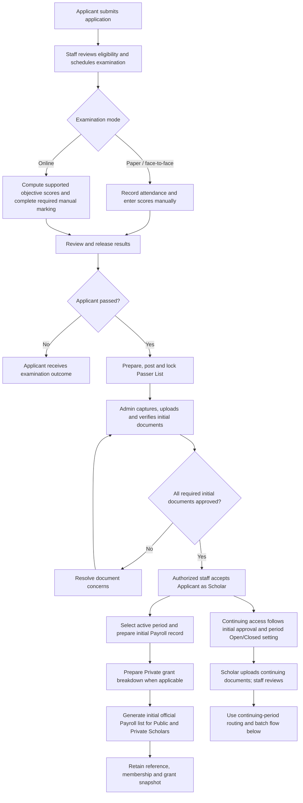
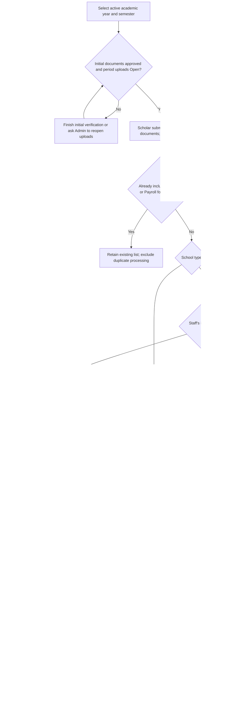

# PGCEAP Application, Scholar, Billing and Payroll Process

Updated: **2026-10-17**  
Audience: Provincial Admin, authorized CAO staff, and project stakeholders.

This guide describes the implemented process from application to official list generation. The system's workflow ends when CAO generates the official Payroll or Billing/certification list. Fund release, claiming, disbursement confirmation, reconciliation, and monetary auditing are outside its scope.

## 1. Application submission

The Applicant completes and submits the application form. Staff reviews the application and determines eligibility for examination.

## 2. Examination scheduling and attendance

Staff schedules eligible Applicants and provides examination instructions. Staff records attendance for the applicable examination.

| Examination mode | Score handling |
| --- | --- |
| Face-to-face / paper | Staff manually enters examination scores. |
| Online | The system computes supported objective scores. Staff completes any required manual marking. |

## 3. Result review and publication

Staff verifies examination results and releases the appropriate results to Applicants. Staff prepares, posts, and locks the Passer List so the official passer records are retained.

**Passing the examination does not yet make the Applicant an accepted or verified Scholar.** Passers must first complete initial document verification. Applicants who do not pass do not proceed through the passer-to-Scholar path.

## 4. Initial document collection, capture, and verification

Passers provide the required hard copies to Admin. Admin captures/scans, uploads, and verifies the initial requirements in the specific Applicant/Scholar record. Available capture options include a computer camera, phone-camera transfer, and existing files.

**Admin handles every initial requirement upload**, including initial Grades, Registration Form, and the Tuition Receipt applicable to Private-school Scholars.

| Initial requirement | Public-school Scholar | Private-school Scholar | Uploaded by |
| --- | --- | --- | --- |
| Certificate of Tax Exemption | Required | Required | Admin |
| Valid ID photocopy | Required | Required | Admin |
| Certificate of Grades | Required | Required | Admin |
| Registration Form | Required | Required | Admin |
| Tuition Receipt | Not required | Required | Admin |
| Barangay Indigency | Optional | Optional | Admin, when provided |

Staff resolves document concerns during verification. All required initial documents must be approved before acceptance. Optional Barangay Indigency does not block completion.

## 5. Acceptance as a Scholar

Once required initial documents are approved, authorized staff accepts the passer as a Scholar. Initial documents and verification history remain retained.

Continuing-upload eligibility follows initial approval and period access; it does not require staff to open uploads individually for each Scholar.

## 6. Initial Payroll preparation

**Both Public and Private Scholars follow Payroll for initial processing.**

1. Open **Scholar → View details → Billing & Payroll**.
2. Select the intended active academic year and semester.
3. Prepare the processing record for that Scholar and period.
4. For a Private Scholar, save the required grant breakdown before list generation.
5. Use the existing preparation action to open Payroll.

### Private grant calculation

| Field | Behavior |
| --- | --- |
| Total Grant | Fixed at **PHP 5,000.00**. |
| Tuition Fee Assistance | Staff manually enters the eligible amount from the submitted Tuition Receipt. |
| Allowance | Automatically computed as **PHP 5,000.00 − Tuition Fee Assistance**. |

Tuition assistance must be an explicit amount from PHP 0 to PHP 5,000 with at most two decimal places. Enter zero explicitly when applicable. A missing amount is not treated as zero.

## 7. Initial official Payroll list generation

Staff selects eligible Scholars, moves them into the Payroll queue, and generates the official list.

Generation assigns a list reference and records membership for the selected academic period. Private grant amounts are retained in the generated breakdown, and listed records are locked against duplicate processing.

**Saving preparation in the Scholar drawer is not official list generation.**

## 8. Continuing document submission

For each active academic period, Admin manages continuing uploads at:

**Scholar → Continuing Requirements → select period → Continuing uploads → Save submission access**.

- **Open:** eligible Scholars may upload after required initial documents are approved.
- **Closed:** further continuing uploads are blocked for that period; existing submissions and review history remain preserved.
- Admin may reopen access for the same period when necessary.
- There are no separate regular/late date windows or individual late authorizations in this setup.
- Retired deadline and late-authorization data remains historical; it no longer controls upload access or automatically selects a processing route.

| Continuing requirement | Public-school Scholar | Private-school Scholar | Uploaded by |
| --- | --- | --- | --- |
| Certificate of Grades | Required | Required | Scholar |
| Registration Form | Required | Required | Scholar |
| Tuition Receipt | Not required | Required | Scholar |

Staff reviews the continuing submissions. Initial and continuing files remain separate, tied to their academic periods, with previous versions and review history preserved.

## 9. Regular continuing preparation

| Processing context | Destination |
| --- | --- |
| Initial Public or Private Scholar | Payroll |
| Regular continuing Public Scholar | Payroll |
| Regular continuing Private Scholar | Billing/certification |
| Remaining Private continuing Scholar explicitly sent to Payroll | Payroll |

For a regular Private Billing record:

1. Open **Scholar → View details → Billing & Payroll**.
2. Select the intended active academic year and semester.
3. View the period's Tuition Receipt and enter Tuition Fee Assistance.
4. Check the automatically computed Allowance.
5. Click **Add to billing**.

**Add to billing** validates and saves the grant, saves the processing session, and opens Billing after both requests succeed. Failed requests retain the entered values for correction/retry. This does not generate an official list or change the status to Billed.

Private Payroll preparation retains its existing grant-save and Payroll-opening steps. Public records do not require the Private grant breakdown.

## 10. Regular batch generation

Staff may generate **multiple regular batches for the same academic period**, using different, unlisted Scholars.

- Public regular continuing records use Payroll. Its Excel list follows the provided form with Seq, Name, School, Tuition, Allowance, Amount and Signature; unrecorded breakdowns remain blank.
- Private regular continuing records use Billing/certification. Billing saves the official list in the system and downloads Word (`.docx`); saved lists can be downloaded again from Billing history. Billing has no Excel export.
- Each generated batch receives its own reference.
- Earlier lists remain intact.
- A Scholar already included in either Billing or Payroll for that period cannot be included again.
- A Scholar listed in another period can still be eligible for the selected period.

An additional batch is not automatically a late batch. Regular Private records may remain in Billing for another regular Billing/certification batch.

## 11. Remaining or late-submission processing

This path uses the **same existing Payroll section**, without a separate supplemental page or tab.

1. Ensure the intended academic period remains active and continuing uploads are Open if further documents must be submitted.
2. Generate an official regular Billing or Payroll list for that period before using the remaining-Private routing action.
3. Open **Payroll** and select that same academic year and semester.
4. Set **Payroll list → Not included yet**.
5. Review the remaining Public and Private Scholars.
6. Public Scholars already follow Payroll. For an eligible remaining Private Scholar intended for Payroll, click **Send to Payroll** in the row's Status area.
7. Prepare any missing Private grant details in the Scholar drawer for the same period.
8. Select the eligible records and generate another **normal Payroll batch**.
9. Verify the new reference and retained earlier lists.

### When does Send to Payroll appear?

The button requires all of the following:

- An official regular Billing or Payroll list already exists for the selected period.
- The Private Scholar is active, still assigned to Billing, and not included in either generated list for that period.
- The staff account has Payroll access.

**Creating or saving a preparation record alone does not satisfy the first condition.**

Send to Payroll saves an explicit destination choice for that Scholar and period. It does not generate a list or mark the Scholar included. A stale Billing queue cannot generate a list after the destination has changed.

### What does Not included yet mean?

| Record state for the selected period | Appears under Not included yet? |
| --- | --- |
| Already in a generated Payroll list | No |
| Already in a generated Billing/certification list | No |
| Preparation saved, but no official list generated | Yes |
| Listed only in another academic year/semester | Yes, subject to other selected filters |

The filter identifies unprocessed records. **It does not prove lateness.** Choosing an older period, generating a second batch, or lacking membership does not automatically label or route a Scholar as late.

## 12. Period closure and retained records

When submissions for the period are finished, Admin closes continuing-upload access. Existing documents, previous versions, review history, grant records, and generated lists remain preserved.

Only active academic periods may be selected for new preparation. An older period can still be processed while it remains active.

Incomplete requirements remain visible warnings rather than a new list-generation blocker. Active-account, school classification, destination, Private grant preparation, and duplicate-membership safeguards continue to apply.

The process ends at **official Payroll or Billing/certification list generation**. Upload access may be closed separately as an administrative action.

## End-to-end flowchart

## Continuing and remaining-Scholar flowchart

### Reading the diagrams

- The continuing branch can become available after initial approval; the end-to-end diagram does not require initial Payroll generation before continuing uploads.
- The no-upload-access branch concerns uploads only. It does not introduce a new list-generation block for incomplete continuing documents.
- An initial record and a continuing record for the same Scholar cannot both produce duplicate list membership for the same academic period.
- Repeat regular batch generation only for other Scholars without membership in that period.
- Closing uploads preserves history and does not cancel existing lists.

## Verification reference

Use the [period upload and Payroll verification checklist](../qa/2026-10-16/period-upload-payroll-flow.md) for staff testing.

Mermaid diagrams render in compatible Markdown viewers, including GitHub. A viewer without Mermaid support will show the diagram source blocks.
